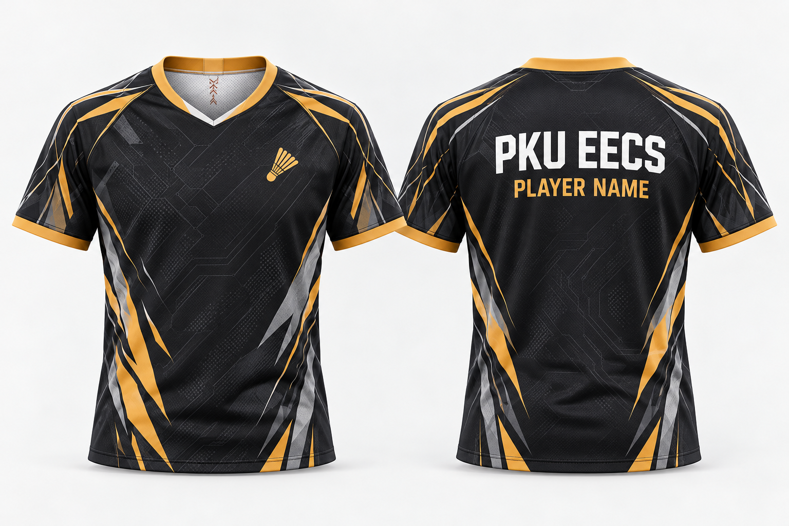
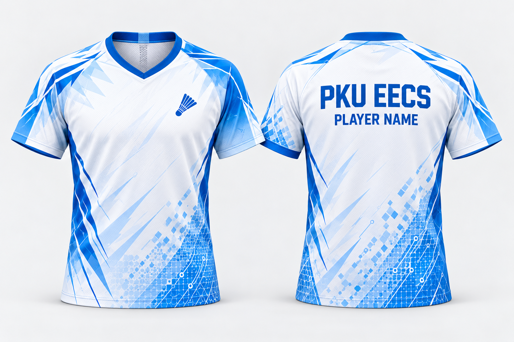

# PKU EECS · 队服共创

一起设计我们的新队服。欢迎从现有方案继续打磨，也欢迎提出全新的设计。

**参与方式：新建分支 → 上传设计 → 提交 Pull Request → 讨论与评审 → 合并收录。**

[如何提交设计](CONTRIBUTING.md) · [版本保留规则](docs/VERSIONING.md) · [修改现有设计](docs/EDITING.md) · [设计说明模板](templates/design/README.md) · [查看 PR](https://github.com/GhostJjaaxx/team-kit-design/pulls) · [讨论想法](https://github.com/GhostJjaaxx/team-kit-design/issues)

**每次迭代新增版本目录，保留已收录设计。** 例如从 `03-white-blue-code/` 复制完整材料到 `03-white-blue-code-v02-yourname/` 后修改新目录，旧版图片、配置和源文件不替换。PR 中同时提供新旧预览和来源版本，首页保留旧版入口。详细步骤见[版本保留规则](docs/VERSIONING.md)。

## 首批设计

以下三张是 2026-10-19 选定的起始效果图，原样收录；每个方案都可以独立迭代。点击图片查看完整尺寸。

| 01 · 炭灰琥珀橙 | 02 · 奶油白酒红 | 03 · 白浅蓝代码渐变 |
| :---: | :---: | :---: |
| [](designs/01-charcoal-amber/preview.png) | [](designs/02-cream-burgundy/preview.png) | [](designs/03-white-blue-code/preview.png) |
| [方案说明](designs/01-charcoal-amber/README.md) | [方案说明](designs/02-cream-burgundy/README.md) | [方案说明](designs/03-white-blue-code/README.md) |
| 深色底、琥珀橙线条、电路元素 | 浅色底、酒红线条、电路元素 | 白色底、浅蓝代码纹样、侧向 EECS |

三款现已附上原始底图、独立胸标、合成配置和设计提示词，可以调整胸标的位置与大小，或继续编辑底图。[修改教程](docs/EDITING.md)提供了可直接运行的命令。首批三张 `preview.png` 保持原样，均不带胸标；胸标是可选素材。

这些材料是平面图片与合成素材，尚无 PSD、AI、SVG 等分层工程；衣服文字、纹样和质感仍在底图中。图案用于讨论，印花生产稿需另行制作。背面的 `PLAYER NAME` 为姓名占位。

## 后续版本 · PR #3

以下 v02 来自 @wangtongyue-pku 的三款迭代，分别完整保存在新的同级目录；首批设计与全部源文件继续保留。新版提供完整平面位图及继承素材，目前没有新增分层工程，具体编辑能力见各版说明。

| 01 · 炭灰琥珀橙 v02 | 02 · 奶油白酒红 v02 | 03 · 白浅蓝代码渐变 v02 |
| :---: | :---: | :---: |
| [](designs/01-charcoal-amber-v02-wangtongyue-pku/preview.png) | [](designs/02-cream-burgundy-v02-wangtongyue-pku/preview.png) | [](designs/03-white-blue-code-v02-wangtongyue-pku/preview.png) |
| [新版说明与源文件](designs/01-charcoal-amber-v02-wangtongyue-pku/README.md) · [父版本](designs/01-charcoal-amber/README.md) | [新版说明与源文件](designs/02-cream-burgundy-v02-wangtongyue-pku/README.md) · [父版本](designs/02-cream-burgundy/README.md) | [新版说明与源文件](designs/03-white-blue-code-v02-wangtongyue-pku/README.md) · [父版本](designs/03-white-blue-code/README.md) |
| 保留炭灰与琥珀橙配色，调整电路线条和斜向运动纹样，加入羽毛球胸部图案。 | 保留白色与酒红方向，调整配色比例和线条布局，加入羽毛球图案、校园塔景与水面剪影。 | 延续白蓝方向，采用蓝色 V 领、斜向运动线条、像素与网格纹样，加入羽毛球图案；新版未沿用原版侧向 EECS 与密集微代码字形。 |

## 你可以做什么

- **迭代已有方案：** 复制完整方案到新的版本目录，只修改新目录；保留旧版、原作者及来源版本，并提供新旧预览对照。
- **新增或独立衍生方案：** 复制设计说明模板到新的方案目录，附 `preview.png`；衍生设计写清来源。
- **参与讨论：** 在 PR 中提出具体修改建议，或开 Issue 讨论配色、版型、队徽与印花。

PR 合并代表收录进候选方案库，不代表已经确定最终队服。未完成的设计也可以先提交 Draft PR 交流。

## 文件怎么放

```text
designs/
  01-charcoal-amber/       炭灰琥珀橙
  02-cream-burgundy/       奶油白酒红
  03-white-blue-code/      白浅蓝代码渐变
  03-white-blue-code-v02-yourname/  后续版本目录示例，按实际投稿新增
templates/design/         新方案说明模板
scripts/render-design.ps1  本地合成底图与可选胸标
.github/                  PR 模板与设计历史检查
scripts/check-design-versions.py  检查旧版未被覆盖或删除
CONTRIBUTING.md            网页与 Git 投稿步骤
docs/EDITING.md            素材说明与本地修改教程
docs/VERSIONING.md         版本目录、旧稿保留与待合并 PR 整理
docs/MAINTAINERS.md        成员与审核管理说明
```

每个版本至少包含 `README.md` 和真正的 PNG 格式 `preview.png`。补充视图放入 `previews/`，底图、独立素材、合成配置或分层工程放入 `source/`，在说明中写清文件类型和编辑能力。脚本默认将试做结果输出到 `generated/`；确认后同步到本次新增版本目录。已有目录的根 `README.md` 可补版本导航或更正说明，其余材料保留原样；不能仅以 Git 历史或一张旧预览代替完整版本。

## 成员与审核

仓库由 [@GhostJjaaxx](https://github.com/GhostJjaaxx) 管理。有兴趣参与的同学把 GitHub 用户名发给仓库负责人，接受 collaborator 邀请后即可在仓库内建分支、提交和评审 PR。尚未加入的同学也可以通过 fork 提交 PR。

团队约定：所有设计变更通过 PR，至少由一位非作者、有写入权限的成员批准，并解决评审讨论后再合并。平台规则由仓库管理员配置，详见[维护说明](docs/MAINTAINERS.md)。

## 素材说明

首批图片由仓库负责人选定并提供，属于通过内置 `image_gen` 工具制作的 AI 辅助概念设计。各方案的 `source/SOURCE.md` 记录补充素材的来源，`source/PROMPTS.md` 保存设计提示词。原始设计与素材的完整署名、授权状态仍待确认；新增素材也请注明来源及授权状态。仓库暂未指定开源许可证，公开展示不等于授予任意使用或商用许可。
