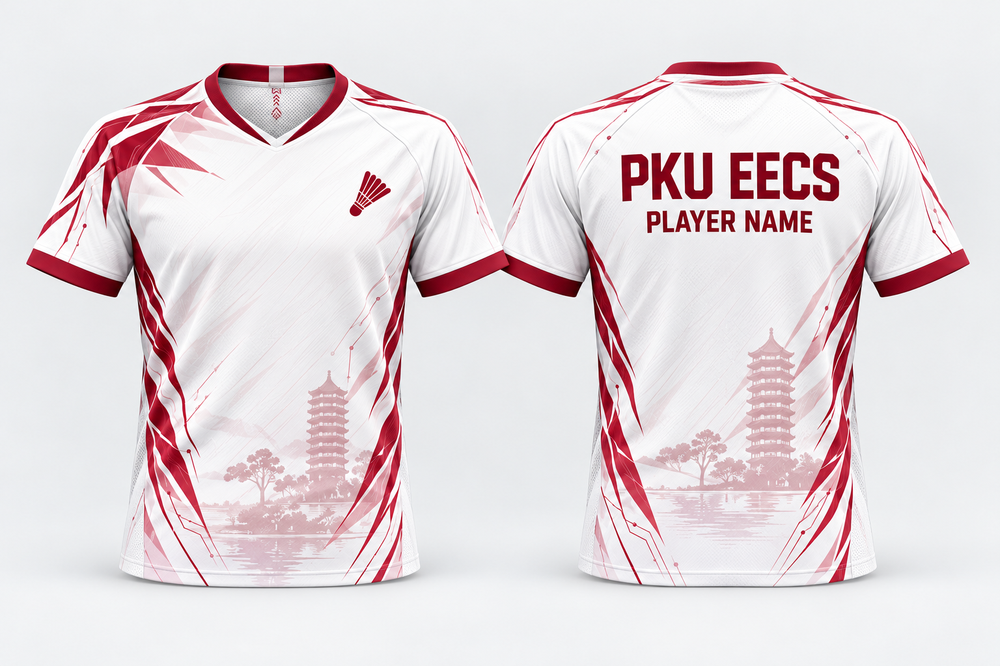
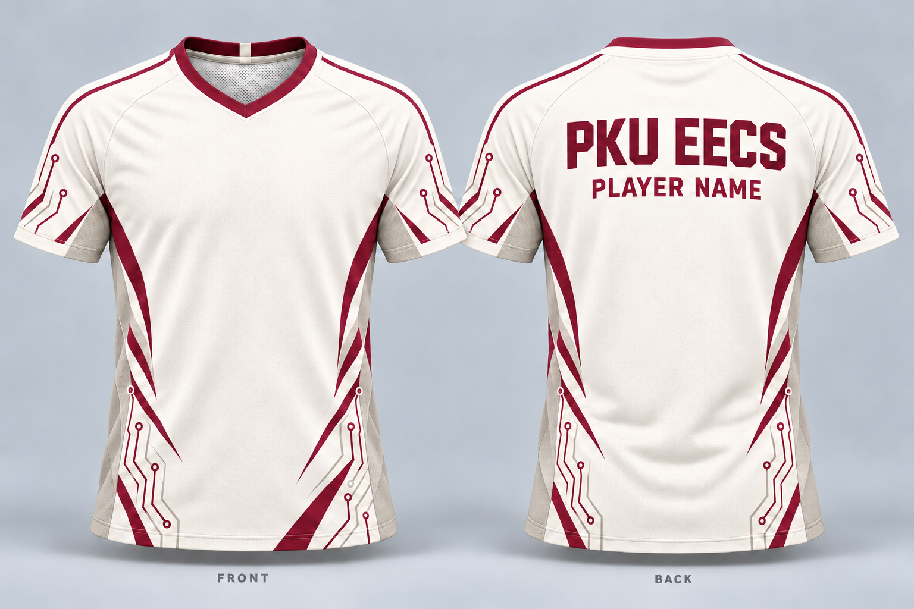

# 奶油白酒红 · v02



| 项目 | 内容 |
| --- | --- |
| 版本标签 | v02 |
| 本版本目录 | `designs/02-cream-burgundy-v02-wangtongyue-pku/` |
| 父版本 | [designs/02-cream-burgundy/](../02-cream-burgundy/README.md) |
| 开始修改时目标分支的完整提交 SHA | `44c05a5334981224ed1ad8425428aa8527af5860` |
| 基线说明 | 原 PR #3 与 main 的共同基线；本次整理已同步 main `69d30299f447c45eff67b3dba37037601fdffbe2`，保护检查使用当前 `origin/main` |
| 初始提交者 | [@GhostJjaaxx](https://github.com/GhostJjaaxx)，负责选定并提供首批图片及补充制作材料 |
| 原始设计署名 | 待补充；初始提交者不等同于全部素材的原作者 |
| 本次贡献者 | [@wangtongyue-pku](https://github.com/wangtongyue-pku)，PR #3 的设计迭代 |
| 方案状态 | 概念候选稿，讨论中；未打样 |
| 制作材料 | 新版完整平面位图、父版全部素材及本版配置；暂无独立文字、羽毛球图案、纹样、字体或 PSD/AI/SVG 分层工程 |

## 本次修改

保留白色与酒红方向，调整配色比例和线条布局，加入羽毛球图案、校园塔景与水面剪影。

本次目录整理不重新生成图片；`preview.png` 与 [PR #3 原始提交](https://github.com/GhostJjaaxx/team-kit-design/commit/e2ba141ba16e539dc099301eaf768ed773e3fe17) 中该方案的预览文件逐字节一致。`PLAYER NAME` 仍为占位。

## 新旧对照

| 父版本 | v02 |
| :---: | :---: |
| [](../02-cream-burgundy/preview.png) | [](preview.png) |
| [原版说明](../02-cream-burgundy/README.md) | [新版源文件](source/) |

## 文件清单与编辑能力

| 文件 | 用途 |
| --- | --- |
| [preview.png](preview.png) | 新版正反面概念效果图，1536 × 1024 |
| [source/pr3-artwork.png](source/pr3-artwork.png) | 从 PR #3 原样保存的完整新版平面位图，是本版默认合成输入；已包含羽毛球图案 |
| [source/composition.json](source/composition.json) | 使用新版位图，默认不额外叠加胸标 |
| [source/base.png](source/base.png) | 父版完整继承材料；用途与来源见下文 |
| [source/composition-parent.json](source/composition-parent.json) | 父版完整继承材料；用途与来源见下文 |
| [source/SOURCE-parent.md](source/SOURCE-parent.md) | 父版完整继承材料；用途与来源见下文 |
| [source/PROMPTS.md](source/PROMPTS.md) | 父版完整继承材料；用途与来源见下文 |
| [source/lion-v6.png](source/lion-v6.png) | 父版完整继承材料；用途与来源见下文 |
| [source/SOURCE.md](source/SOURCE.md) | 本版来源、历史素材边界及复现说明 |

`source/base.png`、独立胸标及历史提示词均来自父版，完整保留供参考；它们不能生成新版纹样。新版可继续做位图编辑，但图中的文字、羽毛球图案和纹样已经合成，未获得可逐元素编辑的原始工程。原 PR 未附新版生成提示词、独立羽毛球图案或字体文件；不能把平面位图声称为分层源工程。

## 复现与继续修改

在仓库根目录运行：

```powershell
& ./scripts/render-design.ps1 -Design 02-cream-burgundy-v02-wangtongyue-pku
```

输出到 `generated/02-cream-burgundy-v02-wangtongyue-pku/preview.png`，默认结果与本版预览逐字节一致。复现只复制现有位图，不重新生成设计。配置保留父版胸标参数供参考，但位置没有针对新版校准；本版图中已有羽毛球图案，使用 `-WithLogo` 可能叠加或重叠旧胸标，须先在新副本调整并检查。

首次合并前继续修改本目录的位图和配置；合并后再迭代须完整复制到另一个唯一的同级目录。见[版本规则](../../docs/VERSIONING.md)与[修改指南](../../docs/EDITING.md)。

## 素材与来源

- 父版的作者记录、全部现有源文件及历史提示词已保留，详见 [父版来源原文副本](source/SOURCE-parent.md)。
- 本版预览来自 @wangtongyue-pku 在 PR #3 上传的改稿；原 PR 声明使用 ChatGPT 辅助构思与图像生成，具体模型、提示词及分层工程未随 PR 提供。
- 图案、字体及参考素材的完整署名、授权和生产适用范围仍待确认；不新增授权声明。原版机器人的来源标记与说明（若有）保留在父版来源原文副本中。

## 变更记录

| 日期 | 贡献者 | 修改内容 |
| --- | --- | --- |
| 2026-10-19 | @GhostJjaaxx | 选定并原样收录首批方案，建立说明与迭代入口 |
| 2026-10-19 | @GhostJjaaxx | 补充底图、独立队徽、合成配置、提示词与来源说明，保留首批预览原样 |
| 2026-10-19 | @wangtongyue-pku | 保留白色与酒红方向，调整配色比例和线条布局，加入羽毛球图案、校园塔景与水面剪影。原始贡献见 PR #3 |
| 2026-10-19 | 本地迁移整理，待作者核对 | 从 PR #3 完整副本迁入本目录，保留父版材料，补齐版本关系和默认复现输入，未更改设计图像 |
